<picture>
  <source media="(prefers-color-scheme: dark)" srcset="https://raw.githubusercontent.com/criptonlabs/.github/main/profile/assets/banner-dark.svg">
  <source media="(prefers-color-scheme: light)" srcset="https://raw.githubusercontent.com/criptonlabs/.github/main/profile/assets/banner-light.svg">
  
</picture>

<p>
  <a href="https://api.criptonlabs.com/docs"></a>
  <a href="https://api.criptonlabs.com/openapi.json"></a>
  <a href="https://api.criptonlabs.com/docs/guides/mcp-quickstart.md"></a>
  <a href="https://api.criptonlabs.com/.well-known/agent-card.json"></a>
  <a href="https://api.criptonlabs.com/llms.txt"></a>
  <a href="https://api.criptonlabs.com/status"></a>
</p>

**Criptonlabs builds read APIs for the XRP Ledger and Solana**, for developers and for the AI agents they ship. Every response is predictable JSON that states how fresh its data is, so your code and your agents never have to guess.

## Criptonlabs Agent APIs

One API at **`https://api.criptonlabs.com`**, three ways in. REST, stateless MCP and A2A return the same JSON.

<table>
  <tr>
    <th align="left" width="50%">XRP Ledger</th>
    <th align="left" width="50%">Solana</th>
  </tr>
  <tr valign="top">
    <td>
      Fees, ledgers, order books, slippage and AMM pools<br>
      Market metrics: pressure, peg, FX basis, arbitrage, liquidity stress<br>
      Accounts, trust lines, offers, escrows and payment paths<br>
      Pre-payment checks and settled payment verification<br>
      Issued assets, MPT issuances and canonical stablecoins
    </td>
    <td>
      Latest finalized slot and network health<br>
      Token verdicts: is this mint safe to hold or receive<br>
      Transfer and fee readiness before you send<br>
      Wallet token hygiene and address kind<br>
      Canonical stablecoins and payment verification
    </td>
  </tr>
</table>

## Every answer states its freshness

Each response carries a `meta` object. Read it before you act on the data.

```jsonc
// GET https://api.criptonlabs.com/v1/xrpl/ledger/latest
{
  "ledger_index": 100234566,
  "close_time": "2026-10-06T12:00:01.000Z",
  "ledger_hash": "A1B2C3D4E5F60718293A4B5C6D7E8F90A1B2C3D4E5F60718293A4B5C6D7E8F90",
  "close_age_seconds": 2,
  "meta": {
    "ledger_index": 100234566,
    "as_of": "2026-10-06T12:00:03.000Z", // when the data was read
    "age_seconds": 0,                    // how old it is now
    "cache": "miss",                     // hit, miss or stale
    "stale": false                       // true only when an old value answered
  }
}
```

When every upstream node fails, the API answers with the last good value and `stale: true`. Past its maximum age, it answers `503` instead of old data.

## Try it

```bash
curl https://api.criptonlabs.com/v1/xrpl/ledger/latest
```

> [!TIP]
> The free tier needs no API key and no account. Start calling it now.

## Connect your agent

```bash
claude mcp add --transport http agent-apis https://api.criptonlabs.com/mcp
```

Every REST endpoint is also an MCP tool. Use `/mcp/xrpl` or `/mcp/solana` to load a single network.

<details>
<summary><b>Cursor</b> (<code>.cursor/mcp.json</code>)</summary>

```json
{
  "mcpServers": {
    "agent-apis": {
      "url": "https://api.criptonlabs.com/mcp"
    }
  }
}
```

</details>

<details>
<summary><b>VS Code</b> (<code>.vscode/mcp.json</code>)</summary>

```json
{
  "servers": {
    "agent-apis": {
      "type": "http",
      "url": "https://api.criptonlabs.com/mcp"
    }
  }
}
```

</details>

<details>
<summary><b>Claude Code</b> (<code>.mcp.json</code>)</summary>

```json
{
  "mcpServers": {
    "agent-apis": {
      "type": "http",
      "url": "https://api.criptonlabs.com/mcp"
    }
  }
}
```

</details>

<details>
<summary><b>A2A</b> (<code>POST /a2a</code>)</summary>

A2A 1.0 over JSON-RPC 2.0. Send a message with a skill and its arguments; the reply is the same JSON the REST endpoint returns. The agent card is at [`/.well-known/agent-card.json`](https://api.criptonlabs.com/.well-known/agent-card.json) and the guide at [`a2a.md`](https://api.criptonlabs.com/docs/guides/a2a.md).

</details>

## Free to read, pay per call for more

| | Free | Pro |
|---|---|---|
| Access | No API key or account | Pay per call with x402, or prepaid credits |
| Routes | `/v1/xrpl/*`, `/v1/solana/*`, `/mcp`, `/a2a` | Mirror under `/v1/pro/*` and `/mcp/pro` |
| Rate limit per IP | 60/min light routes, 15/min heavier, 240/min MCP | 240/min |
| Daily quota | 50 requests per IP per UTC day | Paid per call or from a prepaid balance |
| Payment | None | USDC or EURC on Solana, RLUSD on the XRP Ledger, VAT included |

Prices are per route and published at the [price index](https://api.criptonlabs.com/v1/pro/requirements). Limits are defaults. See the [rate limits](https://api.criptonlabs.com/docs/guides/rate-limits.md), [payments](https://api.criptonlabs.com/docs/guides/payments.md) and [prepaid credits](https://api.criptonlabs.com/docs/guides/prepaid.md) guides.

## Resources

| | |
|---|---|
| Website | [criptonlabs.com](https://criptonlabs.com) |
| API reference | [api.criptonlabs.com/docs](https://api.criptonlabs.com/docs) |
| OpenAPI 3.1 | [openapi.json](https://api.criptonlabs.com/openapi.json) |
| For language models | [llms.txt](https://api.criptonlabs.com/llms.txt) |
| Live status | [api.criptonlabs.com/status](https://api.criptonlabs.com/status) |
| Contact | [hello@criptonlabs.com](mailto:hello@criptonlabs.com) |
